# Zenith DC

## Evolutionary redesign of the radiative building as a data centre

**Round 3 report** · Breeze project · 22 November 2026 · reference load 1 MW IT on the 72 × 48 m Zenith Plate site (hot-dry, Phoenix-like), checked in hot-humid and arid climates.

> **Bottom line.** Housing a data centre flips the physics the Zenith Plate was built on. Liquid-cooled servers return their heat at 40–65 °C, above the outdoor air almost all year. Every surface and fan then becomes a sink, and the cold sky loses its special status. Over seven generations and about 3,000 simulated designs, the evolutionary search kept warm water and dropped the radiative roof. Its winner cuts the annualised cooling cost from $276.4k to $54.1k per year (−80 %). Effective PUE falls from 1.333 to 1.029, and water use is 0.12 L per kWh of IT. A water-neutral variant reaches PUE 1.029 with zero water for $68.5k/yr.

---

## Executive summary

**The brief.** Re-run the whole analysis with the building housing a data centre and challenge everything. Remove what isn't practical. Propose new hypotheses in every generation, test them, and breed the best ideas forward for at least five generations.

**What was done.** A new hourly simulator covers both coolant loops of a data centre for a full year, including a design heat wave. It counts capital cost, fan, pump and chiller energy, extra IT power and water. Seven generations ran on it:

- **G0** challenged and pruned the round-1 and round-2 concepts.
- **G1–G6** each added 3–7 new hypotheses as "genes", ran a genetic algorithm over the expanded design space, then tested every hypothesis fairly. A fair test means the best design with the idea against the best design without it, everything else re-optimised in both cases.
- **G7** stress-tested the finalists.

In all, 30 hypotheses were tested: 12 were confirmed, 13 refuted and 5 had no measurable effect in context.

**What survived and won**

| | Air-cooled baseline | **Zenith DC, cost-optimal** | **Zenith DC, water-neutral** |
|---|---|---|---|
| IT cooling | air + chilled water 18 °C | immersion, 95 % of heat to liquid | immersion, 95 % |
| Warm loop | — | 32–45 °C sliding supply, +20 K | same |
| Heat rejection | chillers | dry coolers + adiabatic pads on peaks | dry coolers + 250 m³ hot-water buffer |
| Electrical rooms | 18 °C chilled water | 30 °C loop: economiser + evaporative | 30 °C loop: economiser + small chiller |
| Effective PUE | 1.333 | **1.029** | **1.029** |
| Water (L/kWh IT) | 0.00 | 0.12 (≈ 1,023 m³/yr) | 0.00 |
| Annualised cooling cost | $276.4k/yr | **$54.1k/yr** | $68.5k/yr |
| Capital cost | $393.6k | $280.5k | $438.0k |

Against the baseline, the cost-optimal design saves about **2.7 GWh of electricity a year per MW of IT**.

**What did not survive.** The radiative roof was tested six separate ways: on the warm loop, on the cool loop, two-sided, as a fin wall, as an integrated roof deck, and in a water-free hotter future. It never paid. Re-optimised, a square metre of sky radiator is worth **$9–32** to a 1 MW data centre, against an installed cost of **$40–430**. The closest call is a radiator built in as the roof deck on the warm loop, worth $32/m² against $40/m². The ground, the seasonal pit, the cold tank, the predictive controller and the vertical fin wall were all refuted on cost.

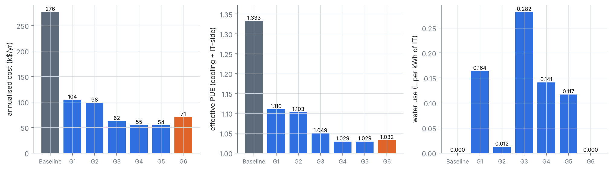

---

## 1. What changes when the building is a data centre

**Scale.** One megawatt of IT produces 8.76 GWh of heat a year, about 24 MWh every day, at every hour. In round 2 the whole 3,456 m² plate moved between about 1 and 7 MWh a day to the sky at 19.5 °C water, depending on the month. Ported unchanged (G0), the round-2 design covers only **20.9 %** of a 1 MW air-cooled data centre's heat (1,979 of 9,461 MWh a year).

**Temperature.** Modern liquid cooling (cold plates or immersion) lets the coolant leave the IT at 40–65 °C, while chips stay within limits. That temperature is above the outdoor air for almost every hour of a Phoenix year. Figure 1 shows the consequence.

At a 55 °C panel on the heat-wave afternoon:

| Panel | Net heat rejected |
|---|---|
| Round-2 film skin | 100 W/m² |
| Open selective panel | 256 W/m² |
| Open PDRC film | 297 W/m² |
| Open white paint | 251 W/m² |

At night the open broadband panels reach 363 W/m². The film and still-air layer that won round 2 now **blocks** the convection that has become useful.

**Reliability.** A data centre must reject 100 % of its heat in the worst hour of the worst heat wave (designed here at 46 °C, four days), with redundant equipment. All active equipment is costed with a 20 % redundancy margin (N+1). Any heat no other sink can take falls to a chiller, which is sized for the worst hour and costed accordingly.

**Metrics.** Four are used:

- **Cooling-only PUE:** 1 + cooling energy ÷ IT energy.
- **Effective PUE:** cooling-only PUE plus the extra IT power that cooling choices cause (server fans, chip leakage at warmer coolant). It compares air and liquid cooling fairly.
- **WUE:** litres of water evaporated per kWh of IT.
- **Annualised cooling cost:** capital × 0.1098 (7 %, 15 years), plus energy at $0.08/kWh, water at $3/m³ and coating upkeep. This is the fitness the evolution minimises.

---

## 2. Method

### 2.1 Weather

A synthetic hourly year was built for each site from the monthly normals used in round 2. It adds:

- day-to-day temperature noise;
- clear and cloudy days drawn from monthly cloud fractions;
- wind with a daily cycle;
- the sun's position;
- the two-band infrared sky (window transmittance from the Berdahl–Martin emissivity and a cloud correction);
- an explicit four-day design heat wave in mid-July, peaking at 46 °C for hot-dry, 39 °C for hot-humid and 47 °C for arid.

The hot-dry year has 218 hours above 40 °C and 1,084 above 35 °C.

### 2.2 Two-loop heat-rejection simulator

The **warm loop** carries the heat captured by liquid cooling (fraction *f* of IT). It is supplied at *T*s (W32, W40 or W45) and returns at *T*s + Δ*T*. The **cool loop** carries the rest: residual air-side IT heat plus electrical and UPS losses (4 % of IT). It is supplied at 18–30 °C and returns 6 K warmer. Each hour, heat passes through the sinks in priority order:

- **Passive panels** (roof, canopy, fin wall) are treated as heat exchangers. Their surface flux is linearised each hour as *q* = *b*(*T* − *T*eq), so a field of area *A* cooling a stream of capacity rate *C* rejects exactly *Q* = *C*(*T*in − *T*eq)(1 − e−*bA*/*C*). The flux includes two-band sky radiation, wind and natural convection, and absorbed sun.
- **Dry coolers:** capacity *G*(*T*mean water − *T*air). Fan power follows speed³, and capacity follows speed0.7. Rated fan power is 1.8 % of rated heat.
- **Adiabatic pads** cool the inlet air to *T* − 0.8(*T* − *T*wb), and the water evaporated is counted (×1.25 for bleed).
- **Hot buffer (warm loop) and cold tank (cool loop):** stratified water. They absorb deficits and are emptied or charged with spare capacity.
- **Seasonal pit:** charged at 12–20 °C. Its soil losses come from the round-2 transient study.
- **Borehole field:** a lumped ground node of 120 m boreholes, with far-field recovery and optional sky recharge from spare roof capacity.
- **Evaporative cooler** (cool loop): used when the wet-bulb is at least 4 K below the loop.
- **Air-cooled chiller:** COP = 0.4 × Carnot, between evaporator (*T*s − 5) and condenser (*T*air + 15), clipped to 2–8.

Pumps take 0.8 % of IT, plus a share of passive and storage flows. CRAH fans take 4 % of the air-side heat. IT-side effects: server fans run at 4 % of IT for air cooling and 0.5–2 % for liquid cooling, and chip leakage adds 0.1 % per K of supply above 30 °C (an assumption).

### 2.3 Cost assumptions (indicative, US 2026, installed)

| Item | Price |
|---|---|
| Electricity / water | $0.08/kWh · $3.0/m³ |
| Dry cooler / adiabatic kit | $90 / $15 per kW rated |
| Air-cooled chiller / evaporative cooler | $350 / $120 per kW |
| Water tank / seasonal pit | $350/m³ + $20k / $60/m³ |
| Boreholes | $55 per metre |
| Radiator panels: hall roof / integrated deck / canopy | $120 / $40 / $320 per m² (+$15 for two-sided) |
| Round-2 cool skin (selective + film cells) | +$110/m², film upkeep $3/m²/yr |
| IT-side premium vs. cold plates 75 % | air −$60, rear-door 85 % +$40, immersion 95 % +$150 per kW IT |
| Redundancy on active plant · capital recovery | ×1.2 · 0.1098/yr (7 %, 15 years) |

These are planning-level figures. Generation 7 shows the ranking survives ±30 % on all of them together.

### 2.4 Evolutionary search

A design is a set of genes, the fields of the `Design` record in `breeze/dc/sim.py`. Each generation runs the same steps:

1. **Open new genes**, which are that generation's hypotheses.
2. **Seed** the population with the previous elite, every single-gene variant of it, and random designs.
3. **Evolve:** 14 iterations of tournament selection, uniform crossover, 18 % mutation and an elite of four; then a coordinate-descent polish.
4. **Test each hypothesis fairly.** The best design *with* the idea (each non-baseline value, all other genes re-optimised) is compared with the best design *without* it (re-optimised the same way).
5. **Score it.** Saving above 0.5 % is *confirmed* and the idea reproduces. Below −0.5 % is *refuted* and the gene is frozen ("pruned"); it can only come back if a later generation re-opens it as a new hypothesis. In between is *no effect*.

The first pass used a simpler single-gene ablation, which was unfair to ideas that only pay when another gene changes too. A roof that allows smaller dry coolers is the example. The paired test replaced it. Across the seven generations about 3,000 distinct designs were simulated.

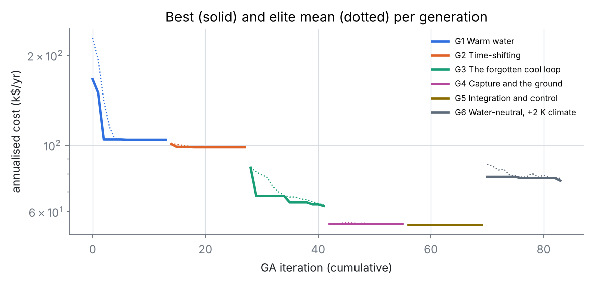

---

## 3. Generation 0: challenge and prune

Every concept from rounds 1 and 2 was put to one question: does it still make physical and practical sense when the heat is 1 MW, continuous, and at 40–65 °C?

| Concept | Verdict | Why |
|---|---|---|
| Comfort loop at 16–21 °C | **removed** | Liquid cooling moves most of the heat to 40–65 °C. Keeping cold water for everything throws away the main advantage. |
| Film over 100 mm still-air cells | **removed** | Above air temperature, convection is a sink, not a leak (Figure 1). A 12 µm film also lasts only about 1–3 years in Phoenix UV and dust, which is unacceptable for mission-critical cooling. |
| Window-selective coating | **removed (warm loop)** | Above ambient every infrared band helps. Broadband paint or PDRC film emits more. |
| Sunk storeys + earth vault | **removed** | Envelope gains are under 1 % of a 1 MW IT load. Excavation (~35,000 m³), flood and access risk buy nothing. |
| Night-flush stacks, earth tubes | **removed** | Liquid-cooled IT does not need outdoor air; desert dust and smoke harm electronics. |
| Mirror funnels | **removed** | Already refuted in round 1; they are also dust traps. |
| Radiator roof, canopy, fin wall | **kept for re-test** | Above ambient they become ordinary heat exchangers with free sky radiation. Tested in G1, G3, G5, G6. |
| Seasonal pit, ground, storage | **kept for re-test** | The roles change: the ground becomes a *sink* for 45–55 °C water. Tested in G2, G4, G6. |
| Air cooling with chillers | **baseline** | The industry reference the evolution must beat: effective PUE 1.333, $276.4k/yr. |

---

## 4. Generation 1: warm water

The seed was the air-cooled baseline. The new genes were the IT cooling method, warm-loop supply temperature, cool-loop supply, radiator roof and its coating, dry-cooler size and adiabatic pads. 149 designs were evaluated.

| Hypothesis | Verdict | Best value | With idea | Without | Saving |
|---|---|---|---|---|---|
| H1.1 Liquid-cool the IT so most heat leaves at 40-55 °C | **confirmed** | D2C 75% | $104.1k | $253.1k | +58.9 % |
| H1.2 The warmer the supply, the cheaper the rejection | **confirmed** | 45.0 | $104.1k | $115.9k | +10.2 % |
| H1.3 A warmer cool loop (22 °C) cuts chiller energy | **confirmed** | 22.0 | $104.1k | $110.5k | +5.8 % |
| H1.4 Above ambient, a radiator roof on the warm loop pays for itself | refuted | hall roof | $128.8k | $104.1k | -23.8 % |
| H1.5 Above ambient, broadband paint beats selective or film coatings | no effect | PDRC film | $104.1k | $104.1k | +0.0 % |
| H1.6 Dry coolers should be sized for the design heat wave | no effect | 0.9 | $104.1k | $104.4k | +0.2 % |
| H1.7 A little water on peak hours beats a chiller | **confirmed** | True | $104.1k | $131.1k | +20.6 % |

**Champion:** annualised cooling cost **$104.1k/yr** (capital $208.9k), effective PUE **1.110**, cooling-only PUE 1.078, WUE **0.164 L/kWh**.

**Reading.** Liquid cooling is the single biggest lever in the whole study, a 59 % cost saving. Once heat leaves at 45–55 °C, dry coolers reject it with fans drawing about 1 % of the heat, and a few hundred litres of water on the hottest afternoons replace a 131k$/yr chiller-sized design.

The radiator roof on the warm loop is refuted, at −24 %. It saves fan energy worth almost nothing and cannot shrink the dry coolers, because on the 46 °C afternoon it delivers only a fraction of its night-time output.

The coating test shows "no effect" because, with no roof in the winning design, the coating changes nothing. Its physics is settled by Figure 1: a broadband emitter beats a selective one above ambient. PDRC film beats white paint in the sun, but costs more and degrades.

**Reproduces:** liquid cooling, W45, a warmer cool loop, adiabatic peak shaving. **Pruned:** the warm radiator roof.

---

## 5. Generation 2: time-shifting

Confirmed warm water leads to the next question: can heat be moved in time and temperature? 422 designs evaluated in total.

| Hypothesis | Verdict | Best value | With idea | Without | Saving |
|---|---|---|---|---|---|
| H2.1 A hot-water buffer bridges heat-wave afternoons into the night | refuted | 250.0 | $109.8k | $98.3k | -11.7 % |
| H2.2 A wider temperature rise across the IT raises the mean radiator temperature | **confirmed** | 20.0 | $98.3k | $103.2k | +4.8 % |
| H2.3 Let the supply temperature slide down when it is cool outside | **confirmed** | True | $98.3k | $100.7k | +2.4 % |

**Champion:** annualised cooling cost **$98.3k/yr** (capital $237.3k), effective PUE **1.103**, cooling-only PUE 1.079, WUE **0.012 L/kWh**.

**Reading.** A larger temperature rise across the IT (20 K) and a supply temperature that slides down to 32 °C in cool weather both pay. The first raises the mean water temperature in the dry coolers. The second cuts chip leakage for most of the year.

The hot-water buffer is refuted *here* only because water is cheap and the adiabatic pads already cover the peak. Figure 2 (left) shows the buffer's real condition. It replaces the peak chiller only when the dry coolers have spare night-time capacity to empty it. With coolers at 1.5–2× load, 500 m³ removes the warm-loop chiller entirely. This finding returns in G6.

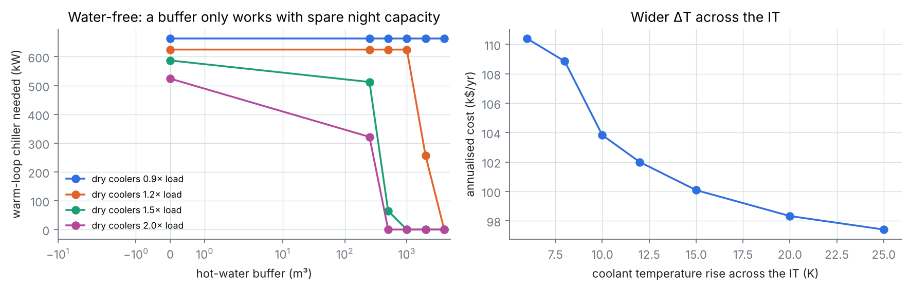

**Reproduces:** 20 K rise, sliding supply. **Pruned for now:** the buffer.

---

## 6. Generation 3: the forgotten cool loop

After G2 the warm loop is nearly free. Most of the remaining cost sits in the **cool loop**: residual air-side heat and electrical losses that need 18–22 °C water, which means chillers. This generation returns the sky plate to the job it was designed for, sub-ambient cooling. 983 designs evaluated in total.

| Hypothesis | Verdict | Best value | With idea | Without | Saving |
|---|---|---|---|---|---|
| H3.1 The sky plate belongs on the COOL loop, where it beats a chiller instead of a fan | no effect | cool | $62.4k | $62.4k | +0.0 % |
| H3.2 A small economiser dry cooler serves the cool loop most of the year | **confirmed** | 1.0 | $62.4k | $65.9k | +5.3 % |
| H3.3 Night sky + economiser charge a cold tank that covers the day | refuted | 250.0 | $74.0k | $62.4k | -18.6 % |
| H3.4 Relax the cool loop to 26 °C | **confirmed** | 26.0 | $62.4k | $92.0k | +32.1 % |
| H3.5 Evaporative cooling for the cool loop | **confirmed** | True | $62.4k | $84.1k | +25.8 % |
| H3.6 Above ambient, a vertical fin wall multiplies radiator area per m² of land | refuted | 720.0 | $121.5k | $62.4k | -94.8 % |
| H3.7 A two-sided canopy doubles the warm radiator | refuted | hall roof | $85.8k | $62.4k | -37.5 % |

**Champion:** annualised cooling cost **$62.4k/yr** (capital $187.7k), effective PUE **1.049**, cooling-only PUE 1.025, WUE **0.282 L/kWh**.

**Reading.** Relaxing the cool loop to 26 °C (ASHRAE's recommended inlet range for the residual air-side IT) is worth 32 %. An economiser dry cooler plus an evaporative cooler then remove most chiller hours. The sky plate, the cold tank, the two-sided canopy and the fin wall all lose on capital cost.

The fin wall would reject 6.7 GWh a year passively, but its $1,296.0k of wetted panels add $142.3k/yr. A fan-blown dry cooler does the same job with about 1 % of the metal.

The break-even study (Figure 3) re-optimises the whole design with and without each roof. It measures what each square metre of sky radiator is worth to a 1 MW data centre.

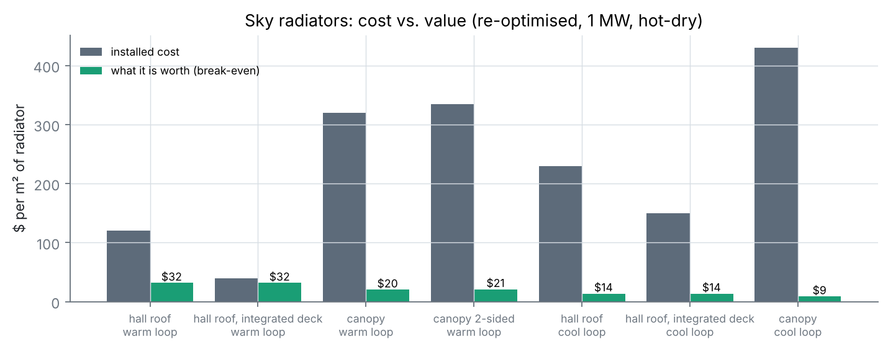

| Option | Installed $/m² | Worth $/m² | Passive heat (MWh/yr) |
|---|---|---|---|
| hall roof on warm loop | 120 | 32 | 7,403 |
| hall roof, integrated deck on warm loop | 40 | 32 | 7,403 |
| canopy on warm loop | 320 | 20 | 8,245 |
| canopy 2-sided on warm loop | 335 | 21 | 8,363 |
| hall roof on cool loop | 230 | 14 | 773 |
| hall roof, integrated deck on cool loop | 150 | 14 | 773 |
| canopy on cool loop | 430 | 9 | 784 |

**Reproduces:** 26 °C cool loop, economiser, evaporative cooling. **Pruned:** sky plate (both loops), cold tank, fin wall, two-sided canopy.

---

## 7. Generation 4: capture more, and try the ground

The confirmed "shrink the cool loop" result leads to capturing more heat in liquid. The warm loop's 45–65 °C also makes the 24 °C ground a sink for the first time. 1762 designs evaluated in total.

| Hypothesis | Verdict | Best value | With idea | Without | Saving |
|---|---|---|---|---|---|
| H4.1 Capture more heat in liquid (85-95 %) to shrink the cool loop | **confirmed** | Immersion 95% | $54.6k | $62.4k | +12.4 % |
| H4.2 The round-2 seasonal pit stores winter sky cold for the cool loop | refuted | 5000.0 | $87.3k | $54.6k | -59.8 % |
| H4.3 At 45-55 °C, the 24 °C ground becomes a sink | refuted | 50 | $88.2k | $54.6k | -61.4 % |
| H4.4 The roof re-cools the ground every winter so it never saturates | no effect | True | $54.6k | $54.6k | +0.0 % |

**Champion:** annualised cooling cost **$54.6k/yr** (capital $280.5k), effective PUE **1.029**, cooling-only PUE 1.019, WUE **0.141 L/kWh**.

**Reading.** Immersion (95 % of heat to liquid) beats cold plates even after a $150/kW IT-side premium. It would still win at a premium of up to about $220/kW. The ground is refuted: 100 boreholes cost about $660k and are only called on in peak hours. They barely warm in ten years (Figure 4) because they are hardly used. Sky recharge cools the field by about 1 K, but recharge has no value if the field is never short. The round-2 seasonal pit is refuted for the same reason: it would store cold for a loop that hardly needs it any more.

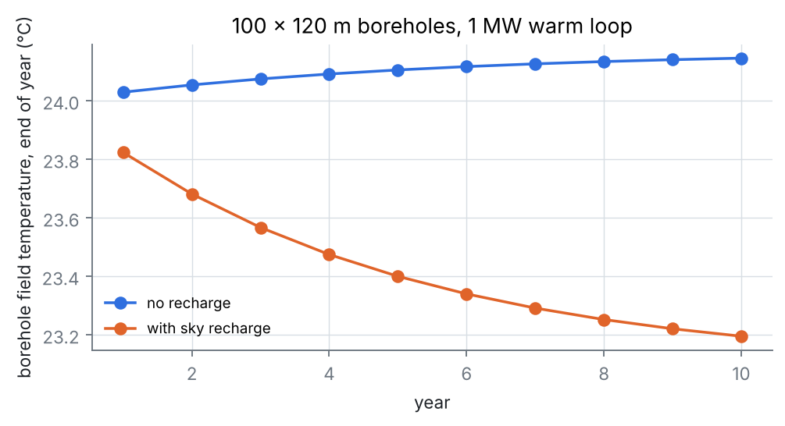

**Reproduces:** immersion. **Pruned:** pit, boreholes, sky recharge.

---

## 8. Generation 5: integration and control

2358 designs evaluated in total.

| Hypothesis | Verdict | Best value | With idea | Without | Saving |
|---|---|---|---|---|---|
| H5.1 Predictive dispatch: throttle fans on hot afternoons, push heat to the buffer, reject it at night | no effect | True | $54.1k | $54.1k | +0.0 % |
| H5.2 Make the radiator the roof itself (integrated deck) to cut its net cost | refuted | hall roof, integrated deck | $57.1k | $54.1k | -5.6 % |
| H5.3 With immersion, electrical rooms can run at 30 °C and lose their chillers | **confirmed** | 30.0 | $54.1k | $63.7k | +15.1 % |

**Champion:** annualised cooling cost **$54.1k/yr** (capital $280.5k), effective PUE **1.029**, cooling-only PUE 1.019, WUE **0.117 L/kWh**.

**Reading.** With immersion, the cool loop is mostly electrical-room heat, and electrical rooms can run at 30 °C. That removes the last chiller, worth 15 %. Making the radiator the roof itself, crediting about $80/m² of membrane and insulation, brings it closest to paying, at −5.6 %, but still not. Predictive fan throttling has no effect because there is no buffer to defer heat into.

**Champion genes (cost-optimal finalist):**

| Gene | Value |
|---|---|
| IT cooling | Immersion 95% |
| warm supply (°C) | 45 |
| warm rise across IT (K) | 20 |
| cool-loop supply (°C) | 30 |
| radiator roof | none |
| dry coolers (× warm load) | 0.9 |
| adiabatic pads | yes |
| hot buffer (m³) | 0 |
| boreholes | 0 |
| cool economiser (× cool load) | 1 |
| cold tank (m³) | 0 |
| seasonal pit (m³) | 0 |
| evaporative cool loop | yes |
| fin wall (m² land) | 0 |
| predictive dispatch | no |
| sliding supply | yes |

---

## 9. Generation 6: water-neutral desert, +2 K climate

Arizona data centres face growing pressure on water. This generation removes water from the design entirely, warms the climate by 2 K, and re-opens the sky, storage and ground hypotheses in that harsher setting.

| Hypothesis | Verdict | Best value | With idea | Without | Saving |
|---|---|---|---|---|---|
| H6.1 Without water, a hot buffer replaces the peak chiller | **confirmed** | 250.0 | $70.6k | $78.0k | +9.4 % |
| H6.2 Without water, the cold sky beats a chiller on the hottest hours | refuted | hall roof, integrated deck | $77.5k | $70.6k | -9.7 % |
| H6.3 Without water, oversize the dry coolers instead | refuted | 1.5 | $72.6k | $70.6k | -2.8 % |
| H6.4 A cold tank charged at night covers the cool loop's hottest hours | refuted | 250.0 | $82.2k | $70.6k | -16.4 % |
| H6.5 The seasonal pit returns when water is not an option | refuted | 5000.0 | $102.8k | $70.6k | -45.6 % |
| H6.6 The ground as a heat-wave sink, re-cooled by the sky | refuted | 50 | $94.8k | $70.6k | -34.2 % |

**Champion (+2 K climate):** annualised cooling cost **$70.6k/yr** (capital $438.0k), effective PUE **1.032**, cooling-only PUE 1.021, WUE **0.000 L/kWh**.

**Reading.** Without water, the **hot buffer comes back and is confirmed** (+9.4 %). 250 m³ of stratified water absorbs heat-wave afternoons, and dry coolers at 1.2× load plus a 2× economiser empty it at night.

Even here, with no water and a hotter climate, the sky loses (−9.7 % for the best roof option). So do the cold tank, the pit and the ground. Oversizing the dry coolers without a buffer is slightly worse than the buffer.

**Champion genes (water-neutral finalist):**

| Gene | Value |
|---|---|
| IT cooling | Immersion 95% |
| warm supply (°C) | 45 |
| warm rise across IT (K) | 20 |
| cool-loop supply (°C) | 30 |
| radiator roof | none |
| dry coolers (× warm load) | 1.2 |
| adiabatic pads | no |
| hot buffer (m³) | 250 |
| boreholes | 0 |
| cool economiser (× cool load) | 2 |
| cold tank (m³) | 0 |
| seasonal pit (m³) | 0 |
| evaporative cool loop | no |
| fin wall (m² land) | 0 |
| predictive dispatch | no |
| sliding supply | yes |

---

## 10. Generation 7: robustness and selection

Three finalists were stress-tested on the base climate:

- **cost-optimal** (G5);
- **water-neutral** (G6);
- **sky-max**: the water-neutral design with the maximum radiative build-out, a 3,456 m² canopy of round-2 cool cells plus a 1,000 m³ cold tank. It shows what the sky would cost.

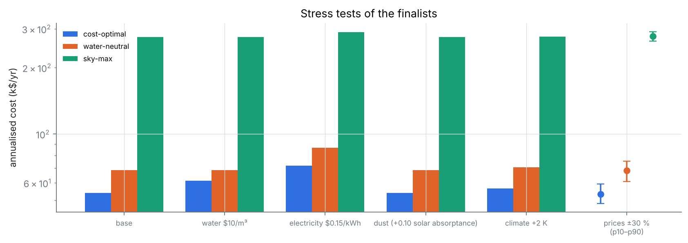

| Stress | Cost-optimal | Water-neutral | Sky-max |
|---|---|---|---|
| base | $54.1k | $68.5k | $275.1k |
| water $10/m³ | $61.2k | $68.5k | $275.1k |
| electricity $0.15/kWh | $71.8k | $86.4k | $290.0k |
| dust (+0.10 solar absorptance) | $54.1k | $68.5k | $275.1k |
| climate +2 K | $56.5k | $70.6k | $276.2k |
| MC p10 | $48.4k | $60.7k | $263.1k |
| MC p50 | $53.3k | $68.3k | $277.4k |
| MC p90 | $59.3k | $75.3k | $291.0k |

The cost-optimal design stays cheapest under every stress, including water at $10/m³ ($61.2k against $68.5k). The water-neutral design costs about 27 % more but uses no water at all. It becomes the cheaper option only if water costs more than about $17/m³, or is banned. Dust has no effect because neither finalist has sun-facing panels.

**Other climates.** The search was re-run from the finalists' genes for each site. The same architecture wins everywhere:

| Site | Annualised cost | Effective PUE | WUE (L/kWh) | Differences |
|---|---|---|---|---|
| hot-dry | $54.1k | 1.029 | 0.117 | — |
| hot-humid | $50.7k | 1.027 | 0.038 | dry coolers 0.9×, economiser 1.0× |
| arid | $56.0k | 1.026 | 0.101 | dry coolers 1.2×, economiser 1.0× |

**Scale.** The plot is fixed, so radiators cannot scale with the IT load. At 10 MW the sky-max roof carries 3.3 % of the heat, against 8.6 % at 0.5 MW. The water-neutral design holds about $67–71 per kW of IT per year at every size.

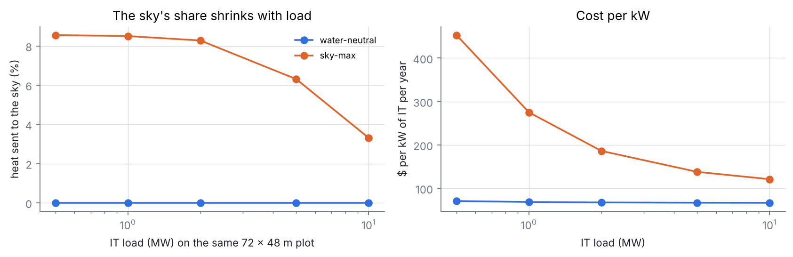

**When would the sky win?** The integrated radiator deck was re-tested on the water-neutral design at $0.08–0.25/kWh and +0/+2/+4 K climates, re-optimising dry coolers, buffer and economiser each time. Its value is at most **$26/m²**, against an installed cost of $40/m² (Figure 7). It falls as the climate warms, because the hottest hours, the ones that set the plant size, are exactly when the warm radiator does least.

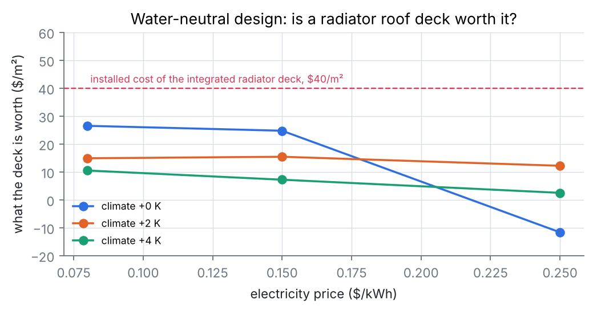

**Selection.** The **cost-optimal** design is the recommended base case. The **water-neutral** design is the alternative where water is scarce or regulated: it differs only in its heat-rejection plant and keeps the same IT, loops and building.

---

## 11. The final design: Zenith DC

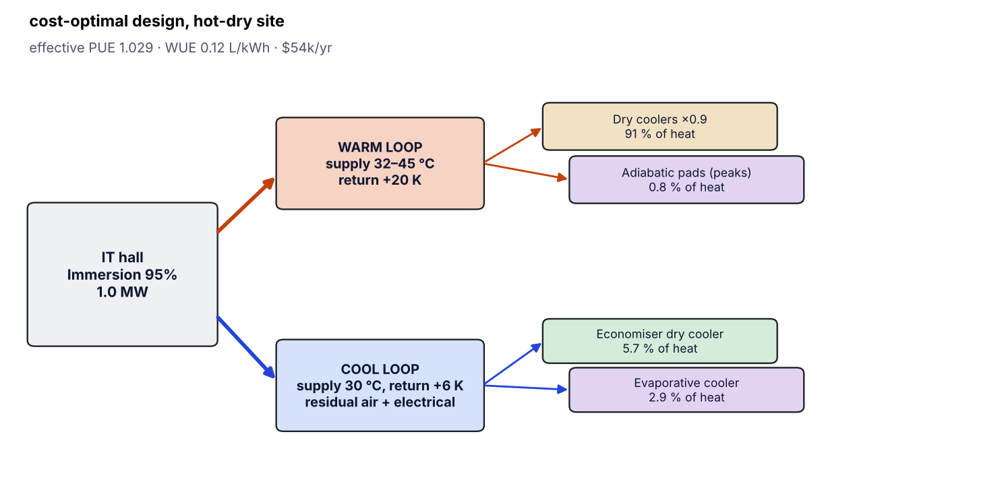

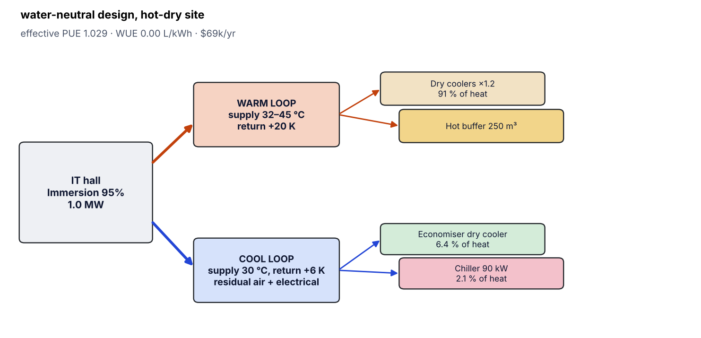

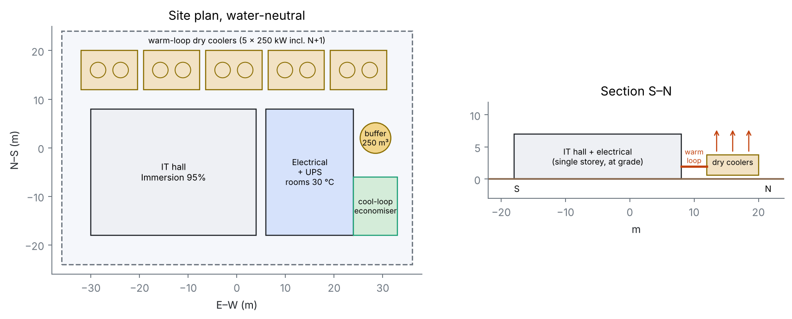

**Building.** A single-storey IT hall at grade, with electrical and UPS rooms at 30 °C and a dry-cooler yard along the north edge of the plot. No sunk storeys, vault, canopy or film. The 72 × 48 m plot holds 1 MW easily and has room for several times that IT load. Space for heat-rejection plant, not the sky, becomes the limit.

**IT cooling.** Single-phase immersion tanks capture 95 % of IT heat in a dielectric fluid. A plate heat exchanger in each tank transfers it to the warm water loop.

**Warm loop.** The supply slides from 32 °C in cool weather to 45 °C at most; return is 20 K higher, up to 65 °C. Dry coolers are sized at 0.9× the warm load (1.2× in the water-neutral design), at 15 K approach, with N+1. Adiabatic pads run only on peak afternoons; in the water-neutral design a 250 m³ stratified hot buffer takes their place.

**Cool loop.** Supplied at 30 °C (36 °C return) for electrical rooms and the residual 5 % of IT heat. An economiser dry cooler runs whenever the air allows, then an evaporative cooler (cost-optimal) or a 90 kW chiller (water-neutral) covers the rest.

**Performance.** The heat-wave dispatch (Figure 11) shows how each design rides the 46 °C peak. The cost-optimal design uses its pads for a few hours each afternoon. The water-neutral design charges its buffer in the afternoon and empties it overnight.

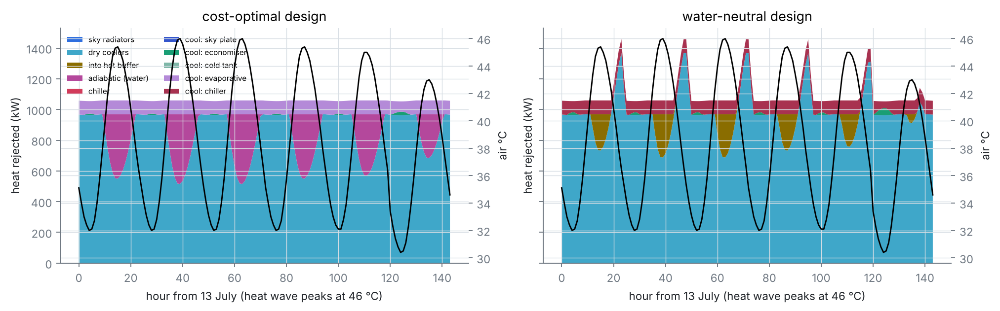

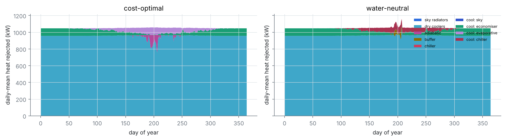

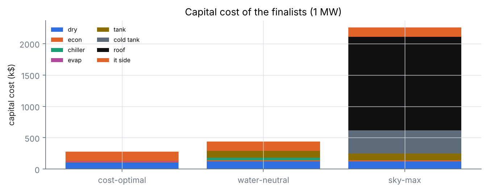

| Key figures (1 MW IT, hot-dry) | Cost-optimal | Water-neutral |
|---|---|---|
| Effective PUE / cooling-only PUE | 1.029 / 1.019 | 1.029 / 1.019 |
| Cooling + pump + fan energy (MWh/yr) | 164 | 167 |
| Water (m³/yr) | 1,023 | 0 |
| Peak chiller (kW) | 0 | 90 |
| Capital cost | $280.5k | $438.0k |
| Annualised cooling cost | $54.1k/yr | $68.5k/yr |

---

## 12. What happened to the radiative building

Rounds 1 and 2 asked how a building can best shed heat to the sky, and the physics found there still holds. A sky-facing, broadband or window-selective plate is the right *shape*. Still air and spectral selectivity are the right *skin* below ambient. Storage across time is what turns sky cooling into a building service.

A data centre changes the *economics*, not the physics:

1. **The heat is warm.** Above ambient, every fan-blown fin is a sink. A dry cooler packs dozens of square metres of fin behind each square metre of face and costs about $90 per kW. A $120/m² sky panel delivers only about 0.2 kW/m² on the design afternoon, roughly $600 per kW.
2. **The heat is huge and constant.** This plot's sky can take about 0.5–1.7 MW of 50 °C heat, depending on the hour. That is significant at 1 MW and marginal at 10 MW.
3. **The sky is weakest exactly when it matters.** Plant is sized for the hottest hour, and on a 46 °C afternoon a warm radiator does a fraction of its night-time work.

The project's real lesson carries over: **match each heat stream to the coldest sink that is cheap at its temperature, and store heat across time only where the sinks are scarce.** For a data centre that means:

- warm water to dry air;
- a 30 °C cool loop to economisers;
- water or a buffer only for the few hours that set the plant size.

The sky plate is worth revisiting if radiator decks fall below about $25/m² installed, or for a sub-ambient process load such as a battery store or offices next to the data centre. Round 2 is the design for that case.

---

## 13. Limits and next steps

- **Weather:** a synthetic year from monthly normals plus one design heat wave, not typical-year or extreme-year weather files. Peak sizing should be checked against ASHRAE 0.4 % and record conditions.
- **Equipment models:** lumped models (dry-cooler UA, Carnot-fraction chillers, lumped ground node). No part-load curves from real equipment, and no CFD of the dry-cooler yard (recirculation, wind).
- **Costs:** planning-level and US-centric. The IT-side premium for immersion is an assumption; it would have to exceed about $220/kW to change the winner.
- **Leakage:** chip leakage of 0.1 %/K is an assumed figure. Higher leakage would favour lower supply temperatures; the sliding setpoint already captures most of that.
- **Not modelled:** electrical losses beyond 4 %, heat reuse (district heating, absorption cooling, desalination) and noise limits. Heat reuse could be the next generation's hypothesis.
- **Next:** hourly typical-year runs for the selected site, a vendor-based dry-cooler and immersion bill of quantities, and a heat-reuse generation.

---

## Appendix A: hypothesis ledger

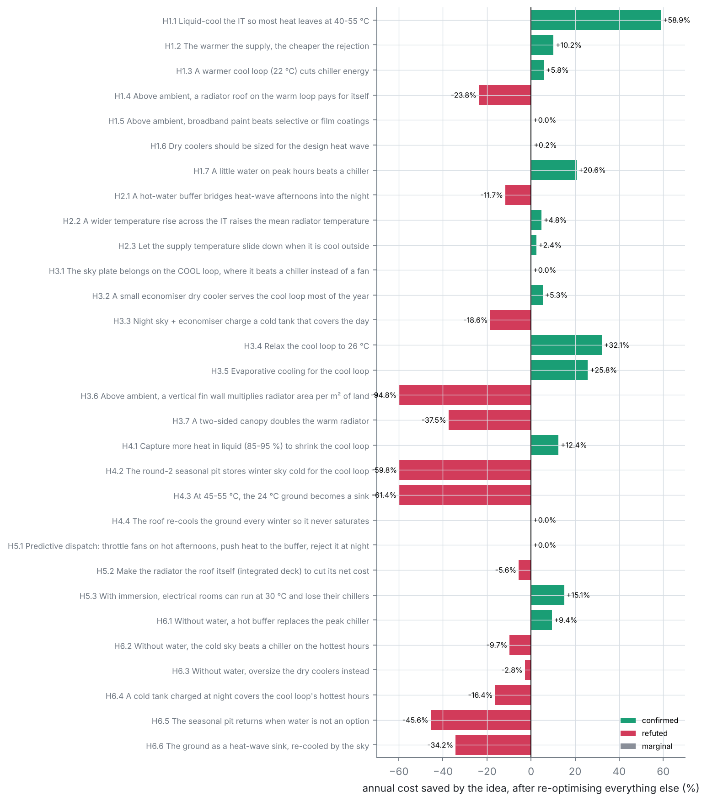

## Appendix B: reproduction

| What | Where |
|---|---|
| Hourly climate generator | `breeze/dc/climate_hourly.py` |
| Two-loop simulator, cost model | `breeze/dc/sim.py` |
| Evolutionary search, paired hypothesis test | `breeze/dc/evolve.py` |
| Generations 0–7 driver | `cae/dc/run_generations.py` (about 7 min on 4 cores) |
| Supplementary checks (buffer sweep, deck window) | `cae/dc/supplement.py`, `cae/dc/rerecord.py` |
| Figures, drawings, this report | `cae/dc/figures.py`, `cae/dc/drawings.py`, `cae/dc/build_report.py`, `cae/dc/md2pdf.py` |
| Raw results | `results/dc/generations.json` |
